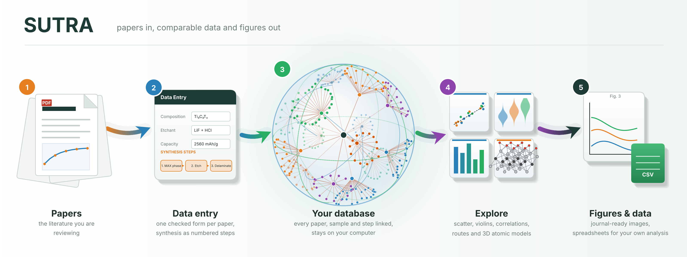

# SUTRA

**A desktop app for comparing quantitative and qualitative data across scientific literature, targeting material science.**

SUTRA collects numbers reported in dozens or hundreds of papers into one
checked, comparable dataset, and makes figures from it:
correlation matrices, scatter and Ragone plots, distributions, rate and cycling
curves, per-paper profiles, and a "where does my material sit" benchmark.

It is in active development to be used for any material science field, now with customazabile varaibles/profiles/databases and simplified data entry compatible with LLMs and ML frameworks.

## Download

> **Beta 2.1, the first public installer, is now out **

Get the latest installer from the **[Releases](../../releases/latest)** page.
Windows 10 or 11.

1. Download `SUTRA_Setup_<version>.exe` and run it.
2. On first launch, choose **Open the demo database** to explore with invented
   example studies, or **Create a new empty database** to start your own.

Your database, settings and saved layouts stay on your computer and this can be offline. Demo datasets are included for MXene and Biomass carbon supercap fields.

## Patch notes

Each release on the [Releases](../../releases) page lists what was added,
changed and fixed.

## Problems and requests

Open an [issue](../../issues) and say which view you were in and what you
expected to happen. Or email mreitmajer1@hawk.illinoistech.edu with images or detailed descriptions of bug/issue. 
